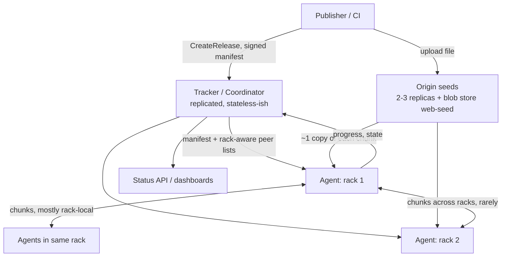

# Distribute a 10 GB File to 10,000 Machines: Comprehensive NALSD Reference

*Sixteenth in the system-design set. A classic NALSD exercise (SRE Workbook Ch. 12 style): start naive, run the math with units, find the first bottleneck, iterate until the numbers close. Reuses ideas from [02-rate-limiter](./02-rate-limiter-nalsd.md) (per-host bandwidth caps), [04.3-warming/thundering-herd](./04.3-distributed-cache-warming-thundering-herd.md) (staggered start, origin admission control), [14-distributed-lock-service](./14-distributed-lock-service.md) (decouple "ready" from "active"), and [12-observability-tracing](./12-observability-tracing.md) (one ID across every log line).*

**Verdict up front:** chunked, rack-aware P2P swarm, signed manifest, per-chunk hash verification, blob store as fallback seed, and distribution decoupled from activation. Naive single origin = **~22.2 hours**; swarm floor = **~20 seconds**, practical target **p50 ~1 min, p99 ~3 min**.

---

## 1. Requirements

### Functional
- Deliver one **immutable** 10 GB file (binary, ML model, DB snapshot) to **10,000 machines**.
- Every machine ends with a **byte-identical, verified** copy; a corrupt copy must never be activated.
- Report **per-machine and fleet-wide progress**; support abort and retry.
- Support later **new versions** of the file (follow-up, Section 11).

### Non-functional
- **Time:** 99% of machines done within 5 min, 100% within 10 min (assumed SLO; ask the interviewer).
- **Do not hurt production:** these machines are serving traffic, so bandwidth and disk use must be capped.
- **No single point of failure** during a rollout (origin, tracker, any one rack).
- **Integrity and authenticity:** a poisoned peer or tampered file must be detected.

### Clarifying questions to ask first (30 seconds, worth saying out loud)
1. Is the file immutable per version? How often does it change? (Decides delta/dedup value.)
2. What is the completion SLO: seconds, minutes, hours?
3. Single datacenter or many? What is the topology (racks, oversubscription)?
4. Are hosts idle or serving live traffic? (Decides the bandwidth cap.)

### Assumptions used below (change them and re-run the math)
| Item | Value |
|---|---|
| File size | 10 GB (decimal; 1 GB = 1,000 MB) |
| Machines | 10,000, one cluster, 40 per rack → **250 racks** |
| Host NIC | 10 Gbps = **1.25 GB/s** |
| Host disk sequential write | **500 MB/s** (SATA SSD; NVMe would be higher) |
| Rack uplink (ToR → spine) | **40 Gbps = 5 GB/s**, so 400 Gbps down vs 40 Gbps up = **10:1 oversubscribed** |
| Origin | one server, 10 Gbps = 1.25 GB/s egress |
| Spine | non-blocking (not the bottleneck) |

---

## 2. Capacity Math (units explicit)

### 2.1 Total data to deliver
```
10 GB/machine × 10,000 machines = 100,000 GB = 100 TB
In bits: 100 TB × 8 = 800 Tbit
```

### 2.2 Per-machine floors (nothing else can be faster than these)
```
NIC floor:   10 GB ÷ 1.25 GB/s = 8 s
Disk floor:  10 GB ÷ 0.5 GB/s  = 20 s   ← binding on a per-machine basis
```
**No design can beat ~20 s here.** Disk is slower than the NIC, so it sets the floor.

### 2.3 Naive: every machine pulls from one origin
```
Origin egress: 100,000 GB ÷ 1.25 GB/s = 80,000 s ≈ 22.2 hours
```
Fails the SLO by roughly 270×. First bottleneck: **origin egress**.

### 2.4 Cross-rack traffic: the number that decides the design
Each rack has 40 machines, each needing 10 GB.

**Random peer selection** (about 99.6% of peers are in other racks, since 249/250):
```
Inbound per rack ≈ 40 × 10 GB × 0.996 ≈ 400 GB
Rack uplink = 5 GB/s
Time = 400 GB ÷ 5 GB/s = 80 s    (4× worse than the 20 s disk floor)
```

**Rack-aware** (pull one copy per rack from outside, share the rest inside the rack through the ToR):
```
Inbound per rack ≈ 10 GB
Time = 10 GB ÷ 5 GB/s = 2 s
Total cross-rack bytes = 250 racks × 10 GB = 2.5 TB  (vs 100 TB): a 40× reduction
```
Rack-awareness removes the uplink as a bottleneck.

### 2.5 Origin seeding in the swarm
The origin only needs to push each chunk into the swarm about once, not once per machine:
```
First full copy out of origin: 10 GB ÷ 1.25 GB/s = 8 s
With ~3× redundancy for faster spread and failure margin: ~24 s of origin egress
```
Origin load drops from 100 TB to roughly 30 GB, about 3,300× less.

### 2.6 Chunking
```
Chunk size 16 MB → 10 GB ÷ 16 MB = 625 chunks
Manifest: 625 × 32 B (SHA-256) = 20 KB   (tiny: ship it on every announce if needed)
Per-peer "have" bitmap: 625 bits ≈ 79 B
```
- Smaller chunks mean more per-chunk overhead and more hashes.
- Larger chunks mean a coarser rarest-first and a slower pipeline start.
- 4 to 64 MB is the sensible range; 16 MB is a defensible default.

### 2.7 Control plane (check it, don't assume)
```
Announce every 10 s × 10,000 agents = 1,000 announces/s
Response: ~50 peers × ~40 B ≈ 2 KB → 2 MB/s total
Connections: 10,000 × ~40 peers = 400,000 (≈40 per host)
```
**Trivial.** One replicated tracker handles it; no sharding needed (unlike the data plane).

### 2.8 Verification CPU
```
SHA-256 ≈ 1 GB/s per core (assumed, hardware-accelerated)
Receiving at 0.5 GB/s → ~0.5 core to hash on the fly
```
This is acceptable, but it counts against the "don't hurt production" budget.

### 2.9 Host-impact cap: the trade-off that sets the real time
Per-host download cap vs time for 10 GB:
| Cap | Rate | Time |
|---|---|---|
| Uncapped | disk-bound 0.5 GB/s | 20 s |
| 2 Gbps | 250 MB/s | 40 s |
| 1 Gbps | 125 MB/s | 80 s |
| 500 Mbps | 62.5 MB/s | 160 s |

Even at a 500 Mbps cap the SLO (5 min) is met. **State the cap explicitly**: it is a product decision, not a protocol limit.

### 2.10 Summary
| Quantity | Value | Binding? |
|---|---|---|
| Total data | 100 TB | |
| Naive origin time | **22.2 h** | Yes, iteration 0 |
| Per-machine floor | **20 s** (disk) | Final floor |
| Rack uplink, random peers | 80 s | Yes, iteration 2 |
| Rack uplink, rack-aware | 2 s | No |
| Origin seeding | ~8 to 24 s | No, overlaps with swarm |
| Tracker load | 1,000 QPS | No |
| Realistic target | **p50 ~1 min, p99 ~3 min** | After caps, tail, startup |

---

## 3. Options Compared

| Approach | Time (this setup) | Pros | Cons |
|---|---|---|---|
| **A. Single origin** | 22.2 h | Trivial | Fails by ~270× |
| **B. Blob store (e.g. GCS) pull** | ~17 min *if* the object sustains an assumed 100 GB/s aggregate: 100 TB ÷ 100 GB/s = 1,000 s | Simplest to operate, no agents | Bound by per-object/bucket limits and egress cost; no rack-awareness |
| **C. Hierarchical tree (origin → regional → rack seeds → hosts)** | ~5 min store-and-forward (14 levels × ~20 s, binary tree, disk-bound) | Predictable, topology-friendly | An interior node dying orphans its subtree; must be tuned and rebuilt |
| **D. P2P swarm (BitTorrent-like), rack-aware** | ~1 to 3 min | Scales with fleet size, self-healing, origin barely touched | Needs an agent and tracker; more moving parts |

**Decision rule worth saying out loud:** if the SLO is ≥ 20 min, **B** wins on simplicity. At a few-minute SLO, or when the file or fleet grows, **D** wins because its time stays flat as N grows while B's grows linearly. Use B as the **fallback seed** inside D.

---

## 4. High-Level Design



**Components**
- **Publisher** builds the release: splits into chunks, hashes them, signs the manifest.
- **Origin seeds:** 2 to 3 replicas plus a blob-store "web seed" fallback, so no chunk lives on only one box.
- **Tracker/coordinator:** serves manifests, hands out rack-aware peer lists, aggregates progress. Not on the data path.
- **Agent** (on every machine):
  - Fetches the manifest and announces its bitmap.
  - Downloads chunks (rarest-first, rack-local preferred) and verifies each chunk hash.
  - Writes to a preallocated partial file and serves chunks to peers.
  - Verifies the whole-file root hash and holds the file **staged**, not active.
- **Activation:** a separate signal flips staged → active (Section 9).

---

## 5. API Design

**Publisher → tracker (gRPC)**
```
CreateRelease(file_uri, root_hash, target_selector, rollout_policy) -> release_id, manifest
Activate(release_id, wave)        // separate from distribution
AbortRelease(release_id)
GetStatus(release_id) -> {state counts, p50/p99 completion, per-rack coverage, bytes_from_origin vs bytes_from_peers}
```

**Agent ↔ tracker**
```
GetManifest(release_id) -> Manifest{chunk_size, chunk_hashes[], root_hash, size, signature}
Announce(release_id, agent_id, rack_id, have_bitmap, state) -> {peers[], next_announce_s}
ReportProgress(release_id, agent_id, bytes_done, state)   // state: PENDING|DOWNLOADING|VERIFYING|STAGED|FAILED
```

**Peer ↔ peer**
```
GET /chunk/{release_id}/{idx}      // HTTP/2, optional Range, mTLS between agents
```

Design notes:
- The **tracker is not on the data path**. If it dies, agents keep trading with cached peer lists.
- Peer lists are ordered **same rack → same row/pod → anywhere**.
- Tag every log line and span with `release_id`, the same correlation-ID habit as doc 12.

---

## 6. Agent Scheduling Rules

- **Rarest-first** chunk selection, so every chunk spreads quickly and the swarm can survive origin loss.
- **Rack-local preference:** prefer peers in the same rack; a cross-rack fetch only when no local peer has the chunk.
- **Per-host caps** on download, upload, and disk I/O (ionice-class), the same idea as doc 02's rate limiter pointed at your own fleet.
- **Parallelism:** about 4 to 8 chunk requests in flight, so a slow peer can't stall progress.
- **Endgame mode:** for the last few chunks, request them from several peers at once and cancel duplicates, which cuts the tail.
- **Startup jitter:** randomize the first announce over ~10 to 30 s so 10,000 agents don't hit the tracker and origin together (doc 04.3's herd lesson). The origin admits only a small number of initial seed connections; everyone else bootstraps through the swarm.
- **Preflight:** check free disk ≥ file size plus margin before starting; fail fast otherwise.
- **Resume:** persist the chunk bitmap next to the partial file, so a crash resumes instead of restarting.

---

## 7. Bottleneck Ladder (find it, fix it, recompute)

| Iteration | Design | First bottleneck | Number | Fix |
|---|---|---|---|---|
| 0 | One origin serves all | Origin egress | 100 TB ÷ 1.25 GB/s = **22.2 h** | Stop serving from one place |
| 1 | Add origin replicas (k) | Doesn't scale: hitting 80 s needs k ≈ 1,000 origins | 22.2 h ÷ k | Let receivers also serve → swarm |
| 2 | Swarm, random peering | Rack uplink | 400 GB ÷ 5 GB/s = **80 s** | Rack-aware peer selection |
| 3 | Rack-aware | Per-host disk floor | 10 GB ÷ 0.5 GB/s = **20 s** | Accept; this is the floor (NVMe lowers it to the NIC's 8 s) |
| 4 | + host-impact caps | The cap you choose | 1 Gbps → 80 s | Set via SLO; relax off-peak |
| 5 | + tail/stragglers | Slowest few machines | p99 ≫ p50 | Endgame mode, timeouts, retries, replace bad peers |

**Pattern worth naming:** the bottleneck migrated from the origin → the network core → the **individual host**. A good NALSD ends when the next bottleneck is something you can't, or shouldn't, remove.

---

## 8. Failure Modes

| Failure | Impact | Mitigation |
|---|---|---|
| **Origin dies mid-rollout** | Chunks only the origin had can't spread | 2 to 3 origin replicas + blob-store web-seed; don't announce wide until each chunk exists on ≥ 2 holders |
| **Tracker down** | No new peer lists | Agents continue with cached lists and peer-exchange gossip; replicate tracker; fall back to rate-limited web-seed |
| **Corrupt chunk / bad disk / malicious peer** | Bad data propagates | Verify every chunk against the signed manifest, drop the peer's chunk and re-fetch, ban repeat offenders; verify the root hash before STAGED |
| **Tampered release** | Fleet-wide bad binary | Signed manifest, mTLS between agents, authorize who can publish |
| **Slow or hung peer** | Stragglers | Per-request timeout, many parallel peers, endgame duplicate requests |
| **Machine crash mid-download** | Wasted work | Persisted bitmap, resume by chunk, idempotent downloads |
| **Disk full** | Download can't finish | Preflight space check, report FAILED with reason, no partial activation |
| **Rack/ToR failure** | 40 machines vanish; rack-local peering lost | Swarm routes around; cross-rack fallback; retry the rack when it returns |
| **Cold start herd** | Tracker/origin overload | Jittered start, origin admission control, web-seed rate limits |
| **Production impact** | Latency regression on serving hosts | Bandwidth/disk caps, abort-on-SLO-breach hook, off-peak scheduling |
| **Partial rollout, mixed versions** | Fleet inconsistency | Staged-not-active, canary waves, activation is an explicit second step |
| **Cross-DC rollout** | WAN is the new bottleneck | Pull **one copy per datacenter** across the WAN, then swarm locally |

---

## 9. Operability & Rollout

- **Decouple distribution from activation** (the same instinct as doc 14's "holding a lock ≠ safe to write"): STAGED machines don't change behavior. Activate in waves (e.g. 1% → 10% → 100%) with health gates between waves.
- **SLIs:** % machines STAGED, time to p50/p99, bytes from origin vs peers, rack-local byte ratio, hash-failure rate, per-host throttling events, tracker latency.
- **SLO example:** 99% STAGED within 5 min, 100% within 10 min, plus zero host-latency SLO regression during rollout.
- **Dashboards/alerts:** stuck machines (no progress for 60 s), origin egress above expected (swarm isn't working), a rack with 0% progress.
- **Rollback:** keep the previous version staged on disk until the new one is stable.

---

## 10. Interview Tips

- **Lead with the numbers:** "100 TB total; one origin at 1.25 GB/s is 22 hours, so the origin can't be on the data path."
- **State the floor:** "A host can't finish before 10 GB ÷ disk rate, so ~20 s is the physics; everything else is overhead on top."
- **The insight interviewers look for is topology:** random P2P still chokes on rack uplinks (80 s); rack-aware cuts cross-rack traffic 40×.
- **Say when you'd *not* build it:** if 17 minutes is fine, blob-store pull wins. Showing that restraint reads as seniority.
- **Name the security model** (signed manifest, per-chunk hashes) before being asked.
- Say "**staged, then activated**." Operational maturity is mostly about this.

---

## 11. Follow-up Questions

- **"What about a new version next week?"** Chunk-level dedup or content-defined chunking means only changed chunks move; with 90% unchanged you move ~1 GB instead of 10 GB. Worth it if versions are frequent and similar.
- **"Multiple datacenters?"** One WAN copy per DC (10 GB × D), then swarm locally; schedule the WAN leg first.
- **"Why not multicast?"** Great on paper, but it needs network support, has no per-chunk retransmit/integrity story, and is operationally fragile in most fabrics.
- **"How is this different from a CDN?"** A CDN pulls on demand and caches near users; here the full set of consumers is known and simultaneous, so push-style orchestration and rack-aware swarming beat per-request caching.
- **"What would you measure first in production?"** Origin egress (should be ~tens of GB, not 100 TB) and rack-local byte ratio (should be ~95%+).

---

## 12. Further Reading

- **Google SRE Workbook, Ch. 12 "Introduction to Non-Abstract Large System Design"**: free, essential; the format this exercise follows.
- **BitTorrent protocol spec (BEP 3)**: free, essential for chunking, rarest-first, endgame mode.
- **Uber Kraken** and **Alibaba Dragonfly** (open-source P2P distribution systems): free, supplementary; real-world versions of this design.
- **Twitter Murder / Facebook's BitTorrent-based deploys** (conference talks and blog posts): free, supplementary; evidence this is production practice.
